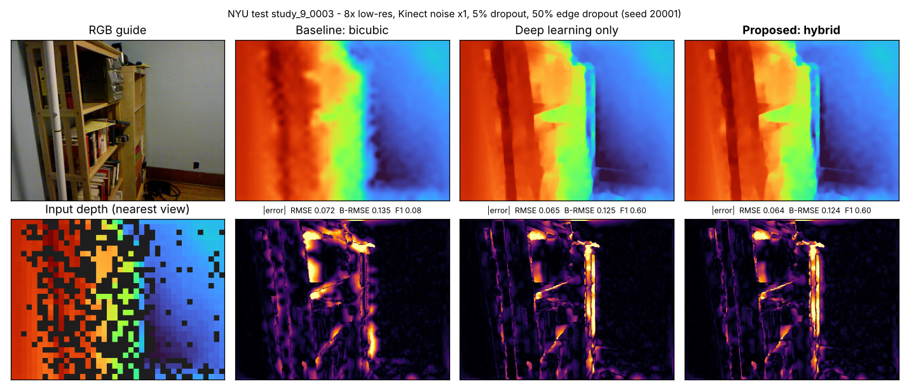
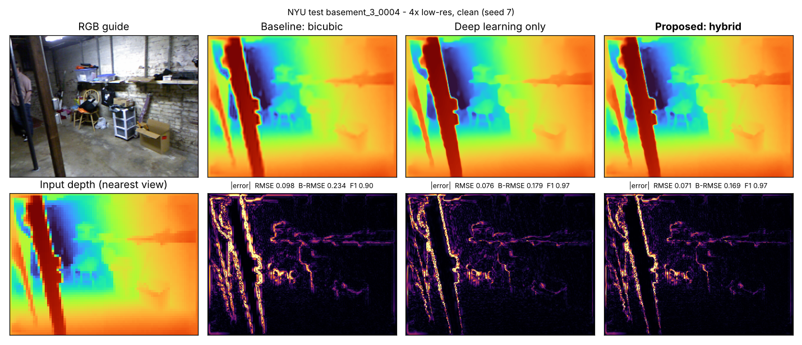
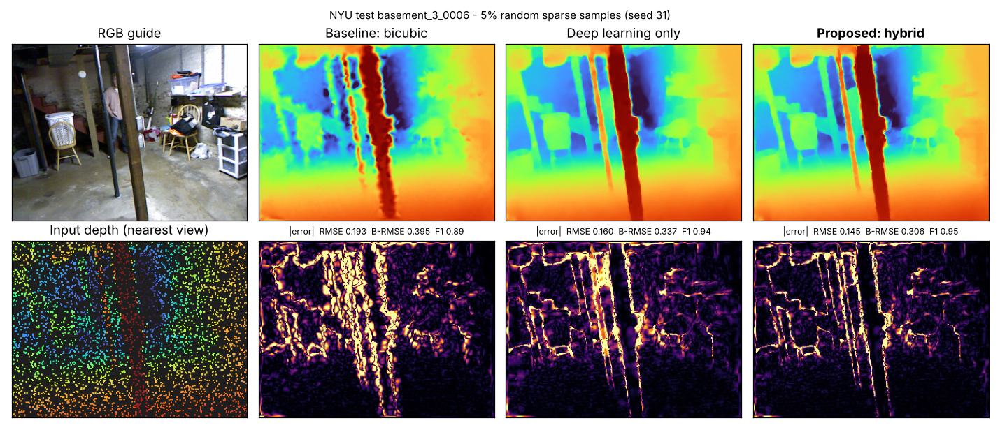
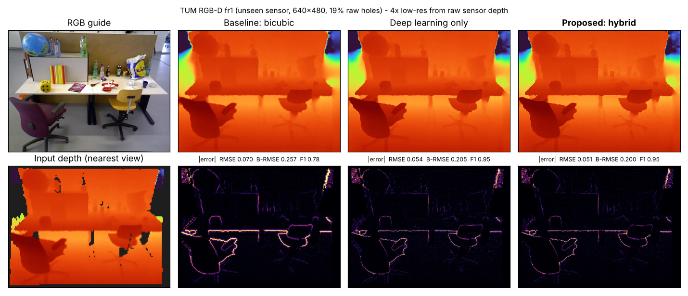

<USN_1>, <USN_2>, <USN_3>

# Evaluation — EdgeDepth: RGB-Guided Edge-Preserving Depth Map Upsampling and Refinement

| | |
| :--- | :--- |
| **Team ID** | T02 |
| **Problem Statement ID** | P4 — Edge-Preserving Depth Map Upsampling and Refinement |
| **Repository** | https://github.com/VarshaSpoorthi-shree/EdgeDepth |
| **Live application** | https://edgedepth-p4.streamlit.app/ |

Every number in this file was produced by our own implementation, on our own hardware, by scripts in the
repository. Nothing is copied from papers.
- **Benchmark:** `scripts/evaluate.py` → `results/summary.json`, `results/per_image.csv`
- **Ablation:** `scripts/ablation.py` → `results/ablation.json`
- **Failure cases:** `scripts/failure_cases.py` → `results/failure_cases.json`
- **Latency and memory:** `scripts/benchmark_latency.py` → `results/latency_memory.json`
- **Image comparisons:** `scripts/eval_cases.py` → `results/eval_cases.json`

All test frames come from scenes that were **never used for training, tuning or fusion fitting**.

---

## 1. Model configuration

| Item | Details |
| :--- | :--- |
| Task | Upsample low-resolution (2×, 4×, 8×) or sparse, noisy, incomplete depth maps to the RGB resolution, using the RGB image as guidance |
| Baseline model | **Bicubic interpolation** — the standard conventional method and the most accurate of our classical methods by RMSE |
| Intermediate model | **EdgeDepthNet** (deep learning only) — custom lightweight CNN (details below) |
| Proposed (optimized) model | **Hybrid** — fusion of bicubic, guided filter, joint bilateral upsampling and EdgeDepthNet by a cue-driven softmax mixture of experts, followed by a noise-adaptive, edge-aware back-projection |
| Network architecture | RGB and depth encoders (1, 1/2, 1/4 scales), depth-gated RGB fusion, 1/8 bottleneck with residual blocks, U-Net decoder; heads for depth residual, boundary probability and 8 affinities; 6-step CSPN propagation. **723,882 parameters** |
| Pretrained model | **None.** Trained from scratch (no ImageNet or other pretrained weights) |
| Dataset | NYU Depth V2: 179 RGB-D frames from 10 indoor scenes, from a public GitHub mirror (the official NYU server was unreachable from our build machine). **Scene-disjoint split:** train 126 frames (6 scenes), validation 29 (2 scenes), **test 24 (2 scenes: `basement_3`, `study_9`)**. Generalisation frames: TUM RGB-D, SUN RGB-D and Redwood (different sensors, never used for training) |
| Input / output resolution | Output (ground-truth) resolution 320×240. Low-resolution inputs 160×120 (2×), 80×60 (4×), 40×30 (8×), or sparse samples on the 320×240 grid. Cross-dataset frames are 640×480 |
| Degradations | Box-averaged downsampling; Kinect depth-dependent noise σ(z) = 1.2 mm + 1.9 mm·(z − 0.4)²; random dropout; edge dropout (sensor shadows); sparse sampling |
| Inference iterations | 1 network forward pass, 6 CSPN propagation steps, 3 back-projection iterations (no diffusion-style sampling steps) |
| Training | 5,000 iterations, batch 8, 128×160 crops, Adam (learning rate 1e-3, cosine decay), loss = edge-weighted L1 + RMSE + gradient + boundary BCE; **51.6 min on CPU** |
| Hardware | **CPU only: 2 cores, 7.8 GB RAM, no GPU** (Linux, Python 3.13, PyTorch CPU). The same code runs on the deployed Streamlit Community Cloud CPU instance |

**Baseline vs proposed (same inputs, resolution and hardware):**
- The **baseline (bicubic)** interpolates the hole-filled low-resolution grid and does not use RGB.
- The **proposed hybrid** adds RGB guidance:
  - two classical edge-aware filters;
  - the learned network;
  - per-pixel adaptive fusion;
  - a data-consistency correction that never crosses depth edges.

**Test protocol** (`scripts/evaluate.py`):
- *Inputs:* 24 test frames × {2×, 4×, 8×} × {clean; noisy + missing (Kinect noise ×1, 5 % random dropout, 50 % dropout on depth edges)}, plus 5 % sparse input — **168 test inputs**.
- *Fairness:* identical inputs and seeds for every method; every method outputs 320×240.
- *Validity:* metrics are computed only on pixels where the ground truth is valid.

---

## 2. Evaluation metrics (in the order of the P4 problem statement)

### 2.1 RMSE and MAE (depth accuracy)

Mean over all 168 test inputs, in metres; lower is better:

| Method | RMSE (m) | MAE (m) |
| :--- | :---: | :---: |
| Nearest neighbour | 0.1125 | 0.0476 |
| Bilinear | 0.0964 | 0.0433 |
| **Bicubic (baseline)** | 0.0921 | 0.0413 |
| Joint bilateral upsampling | 0.0986 | 0.0413 |
| Guided filter | 0.0976 | 0.0446 |
| Deep learning only (EdgeDepthNet) | 0.0690 | 0.0289 |
| **Hybrid (proposed)** | **0.0650** | **0.0264** |

The hybrid lowers RMSE by **29.4 %** and MAE by **36.1 %** relative to the baseline.

**Individual scores — every test frame at 4×, noisy + missing** (`results/per_image.csv`). RMSE and boundary RMSE are in metres.

| Test frame | Bicubic RMSE | DL-only RMSE | **Hybrid RMSE** | Bicubic B-RMSE | DL-only B-RMSE | **Hybrid B-RMSE** |
| :--- | :---: | :---: | :---: | :---: | :---: | :---: |
| basement_3_0001 | 0.0562 | 0.0443 | **0.0429** | 0.1507 | 0.1269 | **0.1214** |
| basement_3_0002 | 0.1199 | 0.0925 | **0.0897** | 0.3263 | 0.2577 | **0.2495** |
| basement_3_0003 | 0.1642 | 0.1153 | **0.1080** | 0.4109 | 0.3020 | **0.2821** |
| basement_3_0004 | 0.1805 | 0.1216 | **0.1137** | 0.4082 | 0.2840 | **0.2651** |
| basement_3_0005 | 0.2212 | 0.1623 | **0.1544** | 0.4679 | 0.3560 | **0.3386** |
| basement_3_0006 | 0.2384 | 0.1559 | **0.1482** | 0.4739 | 0.3257 | **0.3093** |
| basement_3_0007 | 0.2643 | 0.1585 | **0.1522** | 0.5152 | 0.3182 | **0.3060** |
| basement_3_0008 | 0.2670 | 0.1712 | **0.1661** | 0.4991 | 0.3347 | **0.3252** |
| basement_3_0009 | 0.2542 | 0.1510 | **0.1462** | 0.4623 | 0.2880 | **0.2798** |
| basement_3_0010 | 0.1879 | 0.1326 | **0.1263** | 0.3523 | 0.2567 | **0.2454** |
| study_9_0001 | 0.0443 | 0.0346 | **0.0327** | 0.1016 | 0.0815 | **0.0775** |
| study_9_0002 | 0.0447 | 0.0345 | **0.0327** | 0.1055 | 0.0814 | **0.0783** |
| study_9_0003 | 0.0411 | 0.0383 | **0.0355** | 0.0926 | 0.0832 | **0.0780** |
| study_9_0004 | 0.0412 | 0.0357 | **0.0332** | 0.0990 | 0.0867 | **0.0810** |
| study_9_0005 | 0.0366 | 0.0313 | **0.0296** | 0.1019 | 0.0875 | **0.0832** |
| study_9_0006 | 0.0345 | 0.0306 | **0.0282** | 0.0959 | 0.0903 | **0.0831** |
| study_9_0007 | 0.0533 | 0.0384 | **0.0367** | 0.1695 | 0.1245 | **0.1174** |
| study_9_0008 | 0.0614 | 0.0413 | **0.0390** | 0.2370 | 0.1619 | **0.1505** |
| study_9_0009 | 0.0680 | 0.0395 | **0.0387** | 0.2434 | 0.1397 | **0.1363** |
| study_9_0010 | 0.0669 | 0.0440 | **0.0422** | 0.2384 | 0.1594 | **0.1504** |
| study_9_0011 | 0.0549 | 0.0399 | **0.0373** | 0.2133 | 0.1569 | **0.1447** |
| study_9_0012 | 0.0563 | 0.0392 | **0.0370** | 0.1740 | 0.1303 | **0.1217** |
| study_9_0013 | 0.0473 | 0.0295 | **0.0275** | 0.1482 | 0.0897 | **0.0826** |
| study_9_0014 | 0.0544 | 0.0410 | **0.0377** | 0.1574 | 0.1183 | **0.1099** |
| **Average (24 frames)** | **0.1108** | **0.0760** | **0.0723** | **0.2602** | **0.1850** | **0.1757** |

The hybrid has the lowest RMSE and boundary RMSE on **all 24 of 24** test frames. The `basement_3` frames have
larger errors for every method because they contain more distant and more cluttered geometry.

### 2.2 PSNR and SSIM

PSNR uses a fixed 10 m peak (the NYU sensor range). SSIM uses the per-frame ground-truth depth range. Values are
means over the 168 test inputs; higher is better.

| Method | PSNR (dB) | SSIM |
| :--- | :---: | :---: |
| Nearest neighbour | 41.91 | 0.8872 |
| Bilinear | 43.38 | 0.9269 |
| **Bicubic (baseline)** | 43.87 | 0.9259 |
| Joint bilateral upsampling | 43.07 | 0.9235 |
| Guided filter | 43.18 | 0.9264 |
| Deep learning only | 45.92 | 0.9520 |
| **Hybrid (proposed)** | **46.61** | **0.9548** |

Against the baseline, the hybrid gains **+2.74 dB** PSNR and **+0.029** SSIM.

### 2.3 Edge preservation and boundary accuracy

- **Boundary RMSE:** RMSE within 2 px of ground-truth depth discontinuities.
- **Edge F1:** F1 between the predicted and ground-truth discontinuity maps, with 2-px tolerance (boundary accuracy).
- **Edge sharpness:** mean relative depth gradient on ground-truth edges, divided by the ground-truth value. 1.0 means as sharp as the ground truth; below 1 means blurred.

| Method | Boundary RMSE (m) ↓ | Edge F1 ↑ | Edge sharpness (→ 1) |
| :--- | :---: | :---: | :---: |
| Nearest neighbour | 0.2643 | 0.782 | 0.509 |
| Bilinear | 0.2264 | 0.597 | 0.408 |
| **Bicubic (baseline)** | 0.2157 | 0.658 | 0.476 |
| Joint bilateral upsampling | 0.2383 | 0.768 | 0.463 |
| Guided filter | 0.2290 | 0.746 | 0.395 |
| Deep learning only | 0.1659 | 0.870 | 0.698 |
| **Hybrid (proposed)** | **0.1567** | **0.880** | **0.713** |

- **Hybrid vs baseline:** boundary RMSE falls by **27.4 %**, and edge F1 rises from 0.658 to 0.880.
- **Nearest neighbour's edge F1 (0.782) is misleading:** its blocky staircase creates many strong edges, some of which land near true edges. Its boundary RMSE is the worst of all methods.
- **Sharpness:** no method reaches the ground truth's edge sharpness (1.0). The hybrid recovers 71 % of it, against 48 % for bicubic.

### 2.4 Performance across upsampling factors

Mean of the clean and noisy + missing conditions (24 frames × 2 conditions = 48 inputs per factor):

| Method | RMSE 2× | RMSE 4× | RMSE 8× | B-RMSE 2× | B-RMSE 4× | B-RMSE 8× | Edge F1 2× | Edge F1 4× | Edge F1 8× |
| :--- | :---: | :---: | :---: | :---: | :---: | :---: | :---: | :---: | :---: |
| Nearest neighbour | 0.0627 | 0.1045 | 0.1628 | 0.1589 | 0.2530 | 0.3534 | 0.933 | 0.845 | 0.532 |
| Bilinear | 0.0548 | 0.0910 | 0.1455 | 0.1403 | 0.2216 | 0.3158 | 0.878 | 0.636 | 0.204 |
| **Bicubic (baseline)** | 0.0514 | 0.0857 | 0.1381 | 0.1308 | 0.2074 | 0.3027 | 0.917 | 0.695 | 0.294 |
| Joint bilateral upsampling | 0.0552 | 0.0911 | 0.1431 | 0.1427 | 0.2291 | 0.3261 | 0.918 | 0.792 | 0.608 |
| Guided filter | 0.0577 | 0.0918 | 0.1463 | 0.1481 | 0.2234 | 0.3163 | 0.889 | 0.761 | 0.558 |
| Deep learning only | 0.0389 | 0.0610 | 0.1008 | 0.0975 | 0.1495 | 0.2334 | 0.948 | 0.893 | 0.769 |
| **Hybrid (proposed)** | **0.0360** | **0.0577** | **0.0964** | **0.0902** | **0.1417** | **0.2233** | **0.954** | **0.895** | **0.782** |

**Per condition (RMSE in m; bicubic → deep learning only → hybrid):**

| Condition | 2× | 4× | 8× |
| :--- | :---: | :---: | :---: |
| Clean | 0.0347 → 0.0291 → **0.0259** | 0.0607 → 0.0460 → **0.0430** | 0.1045 → 0.0827 → **0.0782** |
| Noisy + missing | 0.0681 → 0.0487 → **0.0461** | 0.1108 → 0.0760 → **0.0723** | 0.1716 → 0.1188 → **0.1147** |

| Other inputs | Bicubic | Deep learning only | **Hybrid** |
| :--- | :---: | :---: | :---: |
| 5 % sparse samples (NYU test, 24 frames) — RMSE (m) | 0.0946 | 0.0814 | **0.0745** |
| Unseen sensors (TUM, SUN RGB-D, Redwood) at 4× — RMSE (m) | 0.0759 | 0.0578 | **0.0561** |
| Unseen sensors at 8× — RMSE (m) | 0.1097 | 0.0859 | **0.0804** |

- **Error grows with the factor** for every method.
- **The hybrid's improvement over bicubic stays at about 30 % at every factor:** 30.0 % at 2×, 32.7 % at 4×, 30.2 % at 8×.
- **Edge F1 separates the methods most at 8×:** 0.782 for the hybrid vs 0.294 for bicubic. Interpolation can no longer represent boundaries at that scale.
- **Best RMSE everywhere:** the hybrid is best in every factor/condition combination, on sparse input, and on unseen sensors.

### 2.5 Processing latency and memory consumption

**Latency** (`scripts/benchmark_latency.py`):
- *Repeats:* 2 warm-up runs, then **10 timed runs** on the same input, on the same 2-core CPU; mean ± standard deviation reported.
- *Memory:* **RAM**, measured in a separate run (no GPU used) as the peak *additional* RAM during one reconstruction. NumPy allocations are tracked with `tracemalloc` and PyTorch with 2 ms process-RSS sampling.
- *PyTorch caveat:* PyTorch reuses its buffers between calls, so the network's incremental RAM is small.

| Method | NYU 320×240, 4× noisy: latency | Peak extra RAM | NYU 320×240, 5 % sparse: latency | TUM 640×480, 4×: latency | Peak extra RAM (640×480) |
| :--- | :---: | :---: | :---: | :---: | :---: |
| Nearest neighbour | 0.3 ± 0.1 ms | 0.6 MB | 4.1 ± 0.1 ms | 1.2 ± 0.1 ms | 2.4 MB |
| Bilinear | 0.3 ± 0.1 ms | 0.6 MB | 37.4 ± 0.2 ms | 1.1 ± 0.0 ms | 2.4 MB |
| **Bicubic (baseline)** | 0.4 ± 0.1 ms | 0.6 MB | 52.5 ± 4.4 ms | 1.4 ± 0.0 ms | 2.4 MB |
| Joint bilateral upsampling | 53.2 ± 0.6 ms | 4.8 MB | 300.7 ± 7.3 ms | 215.9 ± 4.3 ms | 19.0 MB |
| Guided filter | 21.6 ± 0.2 ms | 16.2 MB | 66.3 ± 7.8 ms | 91.3 ± 1.0 ms | 64.5 MB |
| Deep learning only | 65.3 ± 2.2 ms | 2.3 MB | 67.2 ± 1.4 ms | 273.6 ± 7.4 ms | 9.4 MB |
| **Hybrid (proposed)** | **338.9 ± 11.5 ms** | **20.7 MB** | **1489.6 ± 32.7 ms** | **1419.1 ± 23.3 ms** | **82.5 MB** |

| Whole-process RAM (Python + PyTorch + NumPy/OpenCV) | Value |
| :--- | :---: |
| Before loading the model | 573 MB |
| After loading the model | 581 MB |
| At the end of the benchmark (includes cached buffers) | 971 MB |

- **The hybrid is the slowest method:** about 0.34 s per 320×240 frame and 1.4–1.5 s for 640×480 or sparse input. It runs four methods, computes the cue maps and performs three back-projection passes.
- **It still meets the interactive budget:** every case is far below the 10 s response limit.
- **Variance between runs is small:** for every method slower than 20 ms, the standard deviation is at most about 3–4 % of the mean.

### 2.6 Model size

| Model | Stored artefacts | Size on disk |
| :--- | :--- | :---: |
| **Bicubic (baseline)** | none (algorithm only) | 0 MB |
| Classical filters (JBU, guided filter) | none (algorithm only) | 0 MB |
| Deep learning only | `checkpoints/edgedepthnet.pt` (723,882 float32 parameters) | **2.92 MB** (2,915,377 bytes) |
| **Hybrid (proposed)** | network checkpoint + `checkpoints/fusion_params.json` (fusion coefficients: 36 for the full hybrid, 27 for the classical fallback, plus 2 ablation sets) | **2.92 MB** (2,915,377 + 3,532 bytes) |

No compression (quantisation or pruning) was applied. At 2.9 MB the network is already small enough for free CPU
hosting.

### 2.7 Quality vs computational cost

| | Bicubic (baseline) | Deep learning only | **Hybrid (proposed)** |
| :--- | :---: | :---: | :---: |
| RMSE (m), all 168 inputs | 0.0921 | 0.0690 | **0.0650** |
| Boundary RMSE (m) | 0.2157 | 0.1659 | **0.1567** |
| Latency, 320×240, 4× (ms) | **0.4** | 65.3 | 338.9 |
| Peak extra RAM, 320×240 (MB) | **0.6** | 2.3 | 20.7 |
| Model size (MB) | **0** | 2.92 | 2.92 |

- **Quality improved substantially:** RMSE −29.4 %, MAE −36.1 %, boundary RMSE −27.4 %, PSNR +2.74 dB and SSIM +0.029 against the baseline. Most of this gain comes from the network.
- **Final 5–6 % comes from the hybrid's extra stages:** relative to deep learning only, RMSE falls by another 5.8 % and boundary RMSE by 5.5 %.
- **The cost is computation, not size:** the hybrid is about 5× slower than the network alone and needs about 9× its extra RAM.
- **Compared with bicubic,** it is three orders of magnitude slower, yet still under 1.5 s on a 2-core CPU at 640×480.
- **Model size grows only by the 2.9 MB checkpoint.**
- **This trade-off fits an interactive application**, where accuracy at object boundaries matters more than milliseconds. For real-time video, the network alone is the better operating point: 65 ms per frame with 85 % of the hybrid's RMSE gain over bicubic.

---

## 3. Baseline vs proposed model comparison

Same 168 inputs, same 320×240 output, same CPU:

| Metric | Bicubic (baseline) | Deep learning only | **Hybrid (proposed)** | Hybrid vs baseline |
| :--- | :---: | :---: | :---: | :---: |
| RMSE (m) ↓ | 0.0921 | 0.0690 | **0.0650** | −29.4 % |
| MAE (m) ↓ | 0.0413 | 0.0289 | **0.0264** | −36.1 % |
| PSNR (dB) ↑ | 43.87 | 45.92 | **46.61** | +2.74 dB |
| SSIM ↑ | 0.9259 | 0.9520 | **0.9548** | +0.029 |
| Boundary RMSE (m) ↓ | 0.2157 | 0.1659 | **0.1567** | −27.4 % |
| Edge F1 ↑ | 0.658 | 0.870 | **0.880** | +0.222 |
| Latency at 4×, 320×240 (ms) ↓ | **0.4** | 65.3 | 338.9 | slower |
| Model size (MB) ↓ | **0** | 2.92 | 2.92 | +2.92 MB |

---

## 4. Image comparisons

Each figure is produced by `scripts/eval_cases.py`. The top row shows the RGB guide, then the baseline (bicubic),
deep learning only and the proposed hybrid outputs. The bottom row shows the input depth (enlarged with
nearest-neighbour so its pixels stay visible) and each method's absolute error map (0–0.3 m). Colour scales are
shared within a figure.

### Input 1 — 8× upsampling with noise and missing depth

**Exact input:** NYU test frame `study_9_0003` (unseen scene). Depth reduced from 320×240 to 40×30 (8×), Kinect
noise ×1, 5 % random dropout, 50 % dropout on depth edges, seed 20001.

| | Bicubic | Deep learning only | **Hybrid** |
| :--- | :---: | :---: | :---: |
| RMSE (m) | 0.0716 | 0.0648 | **0.0639** |
| Boundary RMSE (m) | 0.1351 | 0.1252 | **0.1242** |
| Edge F1 | 0.081 | **0.604** | 0.602 |

**Differences:**
- **Bicubic:** at 8× each input pixel covers an 8×8 block, so it blurs the shelves and the desk edge into smooth ramps. It finds almost no discontinuities (edge F1 0.08).
- **Deep learning and hybrid:** both use the RGB image to restore the object outlines, raising edge F1 to about 0.60.
- **Hybrid vs network:** the hybrid has the lowest RMSE and boundary RMSE. Its edge F1 is essentially the same as the network's (0.602 vs 0.604).
- **Smallest margin of the four inputs (−1.4 % RMSE vs the network):** at 8× only 40×30 = 1,200 measurements remain, and 5 % random plus 50 % edge dropout removes more. The back-projection runs at full gain here, but it has few constraints near the boundaries, where most of the error is.

### Input 2 — 4× upsampling, clean input

**Exact input:** NYU test frame `basement_3_0004` (unseen scene). Depth reduced to 80×60 (4×), no noise, seed 7.

| | Bicubic | Deep learning only | **Hybrid** |
| :--- | :---: | :---: | :---: |
| RMSE (m) | 0.0982 | 0.0756 | **0.0711** |
| Boundary RMSE (m) | 0.2335 | 0.1787 | **0.1691** |
| Edge F1 | 0.902 | 0.968 | **0.972** |

**Differences:**
- **Bicubic:** the error maps show thick bright bands along the wooden pillar and the shelf edges, because bicubic smears each depth step over several pixels.
- **Deep learning:** narrows these bands.
- **Hybrid:** narrows them further. With clean input the back-projection runs at full strength and pulls the result onto the measured depths. RMSE −27.6 % vs bicubic and −6.0 % vs the network.

### Input 3 — sparse depth completion (5 % of pixels)

**Exact input:** NYU test frame `basement_3_0006` (unseen scene). Only 5 % of the 320×240 pixels have a depth
value, chosen at random (seed 31).

| | Bicubic | Deep learning only | **Hybrid** |
| :--- | :---: | :---: | :---: |
| RMSE (m) | 0.1926 | 0.1604 | **0.1450** |
| Boundary RMSE (m) | 0.3951 | 0.3369 | **0.3063** |
| Edge F1 | 0.891 | 0.943 | **0.953** |

**Differences:**
- **Bicubic:** for sparse input, the bicubic method is Clough–Tocher cubic interpolation of the scattered samples. It produces visible triangular facets and bends object outlines between samples.
- **Network and hybrid:** both follow the RGB object boundaries.
- **Hybrid:** has the largest gain over the network on this input (RMSE −9.6 %), because its back-projection spreads each sample's correction only over pixels of similar colour and depth.

### Input 4 — unseen sensor with real sensor holes

**Exact input:** TUM RGB-D `fr1` frame (Kinect, 640×480), never used in training. The raw sensor depth, with 19 %
missing pixels, is box-downsampled 4× to 160×120. Metrics are computed on the valid raw pixels.

| | Bicubic | Deep learning only | **Hybrid** |
| :--- | :---: | :---: | :---: |
| RMSE (m) | 0.0698 | 0.0539 | **0.0513** |
| Boundary RMSE (m) | 0.2572 | 0.2046 | **0.2004** |
| Edge F1 | 0.777 | 0.951 | **0.954** |

**Differences:**
- **Generalisation:** the network and hybrid work on a different camera and scene type without retraining. The depth normalisation by the mean of D0 makes the model independent of the depth range.
- **Bicubic:** blurs the chair outlines and the table edge, as the error map shows.
- **Hybrid:** has the cleanest chair contours.
- **Remaining errors:** concentrated at the image borders, where the raw sensor depth itself is noisy and has holes.

---

## 5. Ablation study

**What we tested:**
- *Components:* (a) the learned RGB–depth network, (b) its learned edge-aware refinement (CSPN), (c) the classical edge-aware back-projection, (d) the adaptive cue-driven fusion weights, (e) the optional weighted-median boundary snapping.
- *Method:* each variant removes or changes one component and receives exactly the same inputs.
- *Inputs:* 24 test frames × {2×, 4×, 8×} × {clean, noisy + missing} = 144 inputs (`scripts/ablation.py`).
- *Latency column:* mean wall-clock time per input during the ablation run. It was measured with other processes running and is noisier than the controlled timings in Section 2.5; use it to compare variants.

| Variant | RMSE (m) ↓ | MAE (m) ↓ | Boundary RMSE (m) ↓ | Edge F1 ↑ | SSIM ↑ | Latency (ms) |
| :--- | :---: | :---: | :---: | :---: | :---: | :---: |
| A1 Interpolation only (bicubic) | 0.0917 | 0.0420 | 0.2136 | 0.635 | 0.9263 | 0.4 |
| A2 Interpolation + guided filter | 0.0986 | 0.0461 | 0.2293 | 0.736 | 0.9255 | 21 |
| A3 Network backbone only (no CSPN) | 0.0712 | 0.0319 | 0.1693 | 0.846 | 0.9418 | 95 |
| A4a Network + learned refinement (CSPN) | 0.0669 | 0.0283 | 0.1601 | 0.870 | 0.9532 | 93 |
| A4b A4a + classical edge-aware back-projection | 0.0634 | 0.0265 | 0.1518 | 0.877 | 0.9550 | 262 |
| A4c A4a + weighted-median boundary snapping | 0.0758 | 0.0299 | 0.1851 | 0.880 | 0.9480 | 137 |
| **A5 Complete hybrid** | **0.0634** | **0.0265** | **0.1517** | 0.877 | **0.9551** | 338 |
| X1 Hybrid without back-projection | 0.0668 | 0.0283 | 0.1601 | 0.869 | 0.9532 | 171 |
| X2 Hybrid with constant fusion weights (no cues) | 0.0634 | 0.0265 | 0.1517 | 0.877 | 0.9551 | 338 |
| X3 Plain average of the 4 methods | 0.0889 | 0.0423 | 0.2059 | 0.757 | 0.9370 | 172 |
| X4 Hybrid without the network (classical only) | 0.0885 | 0.0387 | 0.2099 | 0.799 | 0.9333 | 258 |
| X5 Hybrid + weighted-median snapping | 0.0720 | 0.0279 | 0.1759 | **0.887** | 0.9502 | 398 |

**How each component affects quality and efficiency:**
- **(a) Learned RGB–depth network (A1 → A3):** the largest quality gain, −22.4 % RMSE, for about 65–95 ms extra per frame.
- **(b) CSPN refinement (A3 → A4a):** −6.0 % RMSE and +0.011 SSIM at almost no extra cost, because it runs inside the same forward pass.
- **(c) Edge-aware back-projection (A4a → A4b, X1 → A5):** −5.2 % RMSE and −5.2 % boundary RMSE. It is purely classical and added about 170 ms per input in this run.
- **(d) Adaptive fusion weights (X2 vs A5):** **no measurable effect when the network is available.** The fitted gate gives the network about 99 % of the weight everywhere, because it is the best method in every cue configuration we observed. Without the network (X4) the fusion is genuinely adaptive: it beats the best classical method (0.0885 vs 0.0917 m). A plain average (X3) is 40 % worse than the hybrid, so fusing without learned weights is harmful. We report this honestly: in the full system, the classical methods and cue maps add time without adding accuracy.
- **(e) Weighted-median snapping (A4c, X5):** gives the highest edge F1 (0.887) but raises RMSE (hybrid: +13.6 %). A pixel snapped to the wrong side of an edge costs a full depth step, so snapping is an optional UI switch, not part of the default system.
- **Classical RGB guidance on its own (A2)** sharpens edges (F1 +0.10) but worsens RMSE. On NYU, many colour edges are texture, not depth edges.

---

## 6. Failure-case analysis

Five controlled failure experiments on 8 unseen test frames (`scripts/failure_cases.py`). Each one can also be run
live on the app's **Failure Analysis** page.

### Failure 1 — Extremely sparse input

- **Input:** NYU test frames with only 0.2 % of pixels measured (about 150 samples per frame). The study sweeps densities from 10 % down to 0.2 %.
- **Output:** see the figure below.

| Density | 10 % | 5 % | 2 % | 1 % | 0.5 % | 0.2 % |
| :--- | :---: | :---: | :---: | :---: | :---: | :---: |
| Bicubic RMSE (m) | 0.0727 | 0.0967 | 0.1392 | 0.1738 | 0.2252 | 0.2747 |
| Hybrid RMSE (m) | **0.0561** | **0.0753** | **0.1034** | **0.1223** | **0.1614** | **0.2264** |

- **What went wrong:** error grows about 4× from 10 % to 0.2 % density. At ≤ 0.5 % the hybrid's RMSE exceeds 0.16 m: chair legs and shelf boards disappear, and smooth but wrong surfaces are filled in.
- **Why:** samples are about 22 px apart, so whole objects contain no measurement. The network was trained only down to 1 % density.
- **Limitation:** below about 1 % density the problem becomes monocular depth estimation, which a 0.7 M-parameter model trained on 126 frames cannot solve.

### Failure 2 — Large missing region

- **Input:** 4× input with a rectangle covering about 20 % of the low-resolution map removed, including object boundaries.
- **Output:** see the figure below.

| RMSE (m) | Bicubic | JBU | Guided filter | Deep learning | Hybrid |
| :--- | :---: | :---: | :---: | :---: | :---: |
| Inside the hole | 0.4777 | 0.4703 | 0.4770 | 0.4391 | **0.4388** |
| Outside the hole | 0.0580 | 0.0747 | 0.0682 | 0.0446 | **0.0413** |

- **What went wrong:** inside the hole every method is about 6–11× worse than outside. Objects lying entirely inside the hole get the wrong absolute depth.
- **Why:** no measurement fixes metric depth there. Classical methods stretch a smooth surface from the hole border. The back-projection deliberately does nothing inside holes (mask = 0). The network infers shape from RGB but cannot know absolute distance.
- **Limitation:** training holes were at most 1/7 of the image, smaller than this one.

### Failure 3 — Excessive sensor noise

- **Input:** 4× input with the Kinect noise model scaled ×1 to ×8 (at ×8, σ ≈ 21 cm at 4 m: 8 × 2.6 cm).
- **Output:** see the figure below.

| RMSE (m) | ×1 | ×2 | ×4 | ×8 |
| :--- | :---: | :---: | :---: | :---: |
| Bicubic | 0.0619 | 0.0656 | 0.0783 | 0.1151 |
| Guided filter | 0.0712 | 0.0729 | 0.0792 | **0.0998** |
| Deep learning only | 0.0470 | **0.0500** | 0.0628 | 0.1072 |
| Hybrid | **0.0451** | 0.0501 | **0.0627** | 0.1068 |

- **What went wrong:** at ×8 noise the hybrid and the network are **worse than the classical guided filter**. In an earlier version, the back-projection made the hybrid much worse (0.135 m at ×8) because it re-injected the noisy measurements.
- **Why:**
  - The training noise range was ×0.3–×2.5, so ×8 is out of distribution and the network passes noise and false edges through.
  - At 8× the noise estimator also confuses scene structure with noise.
  - The fix we implemented, a noise-adaptive gain on the back-projection fitted on validation data, brought the hybrid back to the network's level but not below the guided filter.
- **Limitation:** robustness to extreme noise is limited by the training distribution.

### Failure 4 — Texture copying

- **Input:** the ground truth is a smooth slanted plane (2–4 m), and the RGB guide is a strongly textured tiled image, so every colour edge is texture. 8×, no noise.
- **Output:** see the figure below.

| | Bicubic | JBU | Guided filter | Deep learning | Hybrid |
| :--- | :---: | :---: | :---: | :---: | :---: |
| RMSE (mm) | **2.69** | 7.49 | 3.69 | 8.77 | 5.36 |
| Texture-copy ratio (error on RGB edges / elsewhere; ≤ 1 = no copying) | **0.87** | 1.66 | 0.96 | 1.10 | 1.32 |

- **What went wrong:** JBU's error is 1.66× higher on texture edges, and the hybrid's 1.32×: texture patterns appear in the reconstructed plane. Bicubic, which ignores RGB, is the most accurate here.
- **Why:**
  - Any method that lets colour similarity steer depth assumes that a colour edge is a depth edge.
  - In the hybrid, the RGB term of the back-projection lets some texture through.
  - The network's depth gate keeps its ratio near 1 (1.10), but on this artificial scene it is less accurate overall. The guided filter, with its very small window at 8×, stays below 1.
- **Limitation:** texture copying is reduced, not eliminated. The errors here are only millimetres, but on real scenes they appear as ripples on patterned walls and floors.

### Failure 5 — Incorrect boundaries from RGB–depth misalignment

- **Input:** 8× input, with the RGB image shifted horizontally by 0, 2, 4 and 8 px relative to the depth (a calibration error).
- **Output:** see the figure below.

| Boundary RMSE (m) / Edge F1 | 0 px | 2 px | 4 px | 8 px |
| :--- | :---: | :---: | :---: | :---: |
| Bicubic | 0.2451 / 0.314 | 0.2451 / 0.314 | 0.2451 / 0.314 | 0.2451 / 0.314 |
| Joint bilateral upsampling | 0.2802 / 0.645 | 0.2709 / 0.670 | 0.2857 / 0.578 | 0.2924 / 0.476 |
| Guided filter | 0.2691 / 0.612 | 0.2678 / 0.611 | 0.2723 / 0.599 | 0.2745 / 0.581 |
| Deep learning | 0.1987 / 0.779 | 0.1986 / 0.782 | 0.2276 / 0.739 | 0.2336 / 0.685 |
| Hybrid | 0.1879 / 0.790 | 0.1877 / 0.793 | 0.2108 / 0.737 | 0.2211 / 0.706 |

- **What went wrong:** every RGB-guided method places edges where the shifted colour edge is. A 2 px shift has no measurable effect, but at 4 px and 8 px the errors grow: at 8 px the hybrid's boundary RMSE rises by 18 % and its edge F1 drops by 0.08. Bicubic is unaffected because it ignores RGB, although the hybrid is still better than bicubic.
- **Why:** RGB guidance assumes pixel-accurate registration between the colour and depth cameras.
- **Limitation:** the system has no alignment check or correction step.

---

## 7. Conclusion

- **Reconstruction quality:**
  - EdgeDepth reconstructs dense 320×240 depth from 2×, 4× and 8× low-resolution or 5 % sparse, noisy and incomplete inputs.
  - On unseen NYU Depth V2 test scenes, the proposed hybrid achieves RMSE 0.0650 m, MAE 0.0264 m, PSNR 46.61 dB, SSIM 0.9548, boundary RMSE 0.1567 m and edge F1 0.880.
  - It is the best of the seven implemented methods on all of these, at every factor, and on frames from three unseen depth sensors.
- **Effectiveness of the techniques:**
  - Against bicubic interpolation: −29.4 % RMSE and −27.4 % boundary RMSE.
  - The learned RGB–depth network provides most of the gain.
  - CSPN refinement and the classical edge-aware back-projection each add about 5–6 %.
  - The adaptive fusion weights help only when the network is unavailable; with the network they converge to selecting it. We report this as a finding rather than a success.
- **Computational efficiency:**
  - The accuracy costs compute: 0.34 s per 320×240 frame and about 1.4 s at 640×480 on a 2-core CPU, versus under 2 ms for bicubic on low-resolution input. The hybrid needs about 21–83 MB of extra RAM.
  - The model adds only 2.9 MB of storage.
  - This is well within the 10 s interactive budget of the deployed app.
  - For speed-critical use, the network alone (65 ms per frame) keeps 85 % of the hybrid's RMSE gain over bicubic.
- **Remaining limitations:**
  - Extremely sparse input (< 1 %).
  - Large holes, where absolute depth is unconstrained.
  - Noise far beyond the training range.
  - Residual texture copying.
  - Sensitivity to RGB–depth misalignment.
  - A small training set (126 frames from 6 scenes, trained for 52 minutes on CPU).

---

## 8. Submission checklist

- ☐ Team ID and all members' USNs in the first line *(USN placeholders to be filled in)*
- ☑ Model configuration and hardware details (Section 1)
- ☑ All P4 evaluation metrics in the specified order (Section 2)
- ☑ Baseline versus proposed model comparison (Section 3)
- ☑ Image comparisons for at least three inputs — four provided (Section 4)
- ☑ Ablation study (Section 5)
- ☑ At least three failure cases with explanations — five provided (Section 6)
- ☑ Conclusion (Section 7)
- ☐ This .md file is included in the team's GitHub repository
